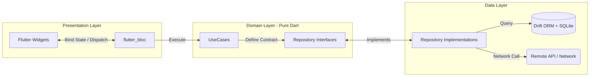

# System Architecture & Tech Stack

## 1. Core Tech Stack & Specifications

| Component                | Technology       | Responsibility                                                                           |
|:-------------------------|:-----------------|:-----------------------------------------------------------------------------------------|
| **State Management**     | `flutter_bloc`   | Handles UI events, encapsulates business states, manages screen side-effects.            |
| **Dependency Injection** | `GetIt`          | Service locator used for explicit dependency registration during app initialization.     |
| **Local Persistence**    | `Drift` (SQLite) | Reactive local storage, handles offline-first data caching and atomic upsert operations. |
| **Rich Text Engine**     | `flutter_quill`  | Manages document/task state via JSON Delta format.                                       |

## 2. Directory Structure & Layer Boundaries

- **`lib/features/<feature>/domain/`**: Feature business logic, including pure Dart models, use cases, and repository
  interfaces. This layer has no dependencies on Flutter, Drift, or network libraries.
- **`lib/features/<feature>/data/`**: Feature infrastructure, including repository implementations, data sources,
  Drift persistence, migrations, and network serialization (`toMap`/`fromMap`).
- **`lib/features/<feature>/ui/`**: Feature presentation, including Blocs, screens, widgets, and dialogs.
- **`lib/core/`**: Shared application utilities and UI infrastructure used by multiple features.
- **`lib/di/`**: Centralized dependency injection via `GetIt` (`service_locator.dart`).

## 3. High-Level Data Flow

The application strictly enforces a Unidirectional Data Flow (UDF) pattern across three isolated layers.

## 4. Backend Services & Cloud Infrastructure

For detailed specifications of external backend servers (`chat-server/` on Render and `functions/` on Firebase Cloud
Functions), refer to [`docs/backend_services.md`](backend_services.md).
