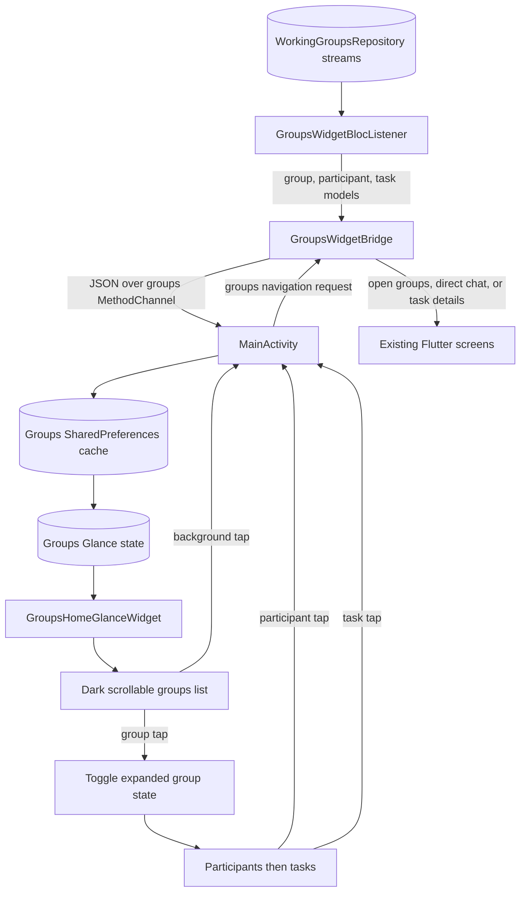

# Feature: AndroidGroupsWidget

## 1. Business Goal & Value

- **Purpose:** Display working groups in a dark, vertically scrollable Android home-screen widget with expandable
  participant and task sections.
- **User Stories Covered:** Expand or collapse a group; open a participant's direct chat; open a group task; open the
  working groups screen from the widget background; reflect group, participant, and task stream changes while the app is
  active.
- The widget uses AndroidX Glance, the Jetpack Compose-based app-widget API. Its provider is registered separately from
  the personal task widget and uses an independent MethodChannel and cache.
- The Android widget picker has a separate rounded dark `previewLayout` with generic collapsed and expanded group
  examples, plus a matching `previewImage` PNG fallback. Preview content is static and does not expose live group data.
- Fixed labels and accessibility descriptions in the live Glance widget are localized in English, Russian, and
  Ukrainian. The selected app language is stored in each widget instance's Glance state; changing it explicitly updates
  every installed groups widget. Picker layouts and fallback images are Android resources, so their language follows
  the device's Android resource locale.

## 2. Architectural Blueprint (Clean Architecture)

### Domain Layer

- **Models:** Existing `WorkingGroup`, `GroupParticipant`, and `GroupTask` models; no domain model changes.
- **Use Cases:** Existing `GetWorkingGroupsUseCase`, `GetGroupParticipantsUseCase`, `GetGroupTasksUseCase`,
  `SyncWorkingGroupUseCase`, and `GetOrCreateDirectChatUseCase`.
- **Repository Interface:** Existing `WorkingGroupsRepository` and chat repository contracts; no contract changes.

### Data Layer

- **Local Persistence (Drift):** No Drift schema change. Android stores a compact JSON presentation snapshot in
  app-private SharedPreferences and mirrors it into Glance per-widget state.
- **Data Mappers:** `GroupsWidgetBridge` maps group, participant, and task models to the native snapshot, including a
  resolved assignee name. Participant entries are deduplicated by the suffix of their composite IDs, preferring an
  accepted participant record to a matching email invitation; the current user's ID/email is marked in the snapshot.
  Native JSON parsing creates widget-only presentation models.
- **Remote Data:** Existing working-group streams and sync use case update the local snapshot; no new remote API.

### Presentation Layer (UI & Bloc)

- **Bloc / Cubit:** None added. `GroupsWidgetBlocListener` owns stream subscriptions and navigation wiring at the main
  screen boundary; group state remains in the existing use cases/repository streams.
- **Components & Screens:** `GroupsHomeGlanceWidget` renders the dark 3×3 default widget as a scrollable list. Each
  group row toggles its expanded state in Glance preferences. Expanded content shows participants first, then tasks.
  Group rows, expansion controls, participant/task chevrons, and task status use tinted Android vector drawables through
  Glance `ImageProvider`; the task status vectors are shared with the personal task widget.
  The current user's participant row is informational only: it has no direct-chat action or right chevron.
  Native item taps return through `MainActivity` and the groups MethodChannel. A background tap selects the existing
  groups tab in `MainScreen`, preserving bottom navigation and root back behavior. A participant tap displays a
  full-screen loading route while `GetOrCreateDirectChatUseCase` resolves the chat ID, then replaces that route with
  `ChatScreen`; the home tab is not exposed during the request. Task taps open `WorkingGroupTaskDetailsScreen`.
- **Coexistence:** The groups widget has a distinct Android receiver, provider metadata, SharedPreferences file, Glance
  state keys, MethodChannel, and intent extras. The personal widget's receiver, task cache, channel, and intent extras
  remain separate.

## 3. Testing Matrix

| Component                                           | Layer                    | Test file(s)                                                                     | Behaviors and cases covered                                                                                                                                                                                                                                                                                                 |
|:----------------------------------------------------|:-------------------------|:---------------------------------------------------------------------------------|:----------------------------------------------------------------------------------------------------------------------------------------------------------------------------------------------------------------------------------------------------------------------------------------------------------------------------|
| Groups Glance provider and Android registration     | Platform                 | No automated widget test; verify with Android compilation and launcher scenario. | Provider is independently installable at 3×3 size; vector icons render for groups, expansion, navigation, and task status; list scrolls; background and item taps route correctly; personal widget remains registered.                                                                                                      |
| Groups snapshot bridge                              | Data / Platform contract | `test/features/working_groups/data/widgets/groups_widget_bridge_test.dart`       | Group snapshot mapping, invited/accepted participant deduplication with accepted-record preference, current-user ID/email matching, assignee-name mapping, empty snapshot, initial navigation payload parsing, and non-Android no-op behavior.                                                                              |
| Groups stream listener and Android Glance rendering | UI / Platform            | Manual Flutter app and Android device/launcher verification                      | Verify group add/remove and participant/task stream updates, direct chat loading/completion, task details, background groups-tab selection, expand/collapse, scrolling, and coexistence with the personal task widget. Flutter bridge tests do not exercise listener lifecycle, Glance rendering, or launcher interactions. |
| Existing personal task widget                       | Platform / Regression    | No new automated test; verify in the same launcher scenario.                     | Personal widget remains installable and its task/background actions still work beside GroupsWidget.                                                                                                                                                                                                                         |
| Groups widget picker preview                        | Platform / Resources     | N/A                                                                              | Verify the rounded dark preview, collapsed/expanded sample cards, and fallback image in the launcher picker; preview data is static and generic.                                                                                                                                                                            |
| Groups widget locale synchronization                | Platform / UI            | N/A                                                                              | Change app language to English, Russian, and Ukrainian; verify empty state, participant/task plural labels, task status accessibility descriptions, and assignee prefix update without restarting the app.                                                                                                                  |

- **Domain:** N/A; existing models and use cases are reused.
- **Data:** No database or repository implementation changes; Android JSON cache behavior is covered by the widget
  snapshot scenarios.
- **Persistence and migrations:** N/A; Drift is unchanged.
- **Bloc/Cubit:** N/A; no Bloc state transitions were added.
- **Widgets and screens:** Verify list rendering, expand/collapse, participant and task navigation, and empty states on
  an Android launcher. Confirm a background tap selects the groups tab with bottom navigation and no nested back arrow.
  Confirm the current user's participant row has no arrow and does not navigate; other participant taps show the loading
  route instead of the home task screen while direct chat is resolved.
- **Widget icons:** Verify the groups, expansion arrow, chevron, and task status vector drawables render with the
  expected
  tints in the launcher widget.
- **Integration or regression:** Install both widgets, add and delete a group from the app, and confirm GroupsWidget
  reflects the changes while the personal task widget retains its existing behavior.

## 4. Data Flow & State Machine (Mermaid)

