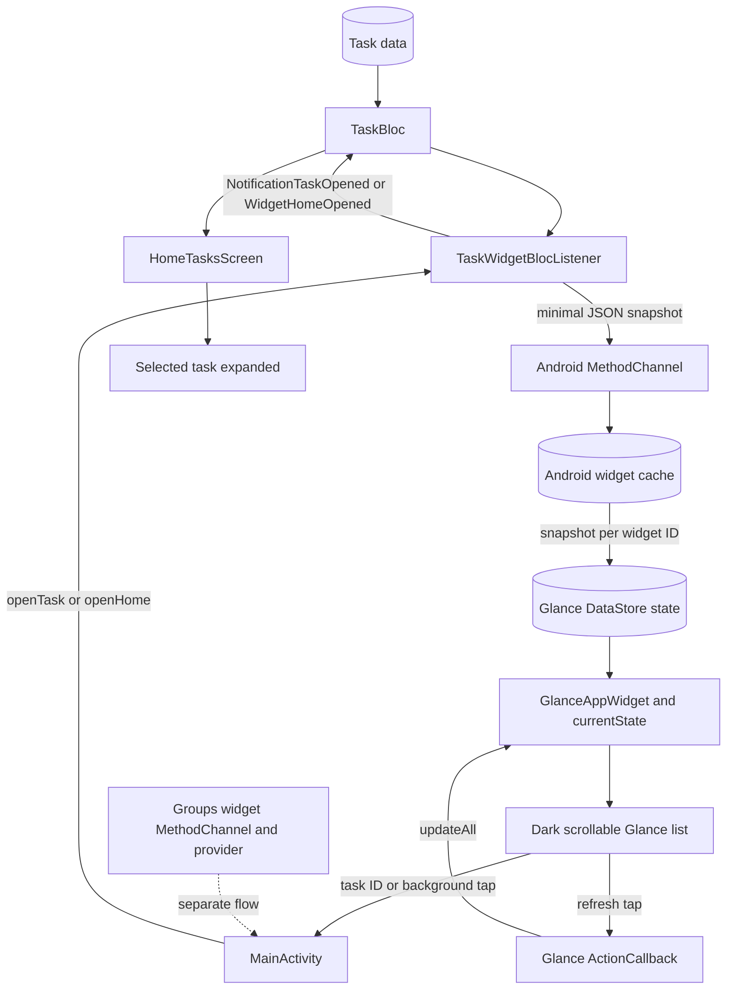

# Feature: AndroidTaskWidget

## 1. Business Goal & Value

- **Purpose:** Display a dark, vertically scrollable list of personal tasks in an Android home-screen widget.
- **Task metadata indicators:** Show checklist, alarm, and attach-file icons for subtasks, deadlines, and attachments,
  respectively, alongside their counts or deadline date.
- **User Stories Covered:** Tap a task to open personal tasks with that task expanded; tap the widget background to open
  personal tasks with every task collapsed; tap the refresh action to redraw the widget from its latest saved task
  snapshot
  without opening the app.
- The widget UI is authored in Kotlin with Jetpack Glance; Android's required widget metadata XML only registers the
  widget and provides its initial loading layout.
- The Android widget picker uses a static, rounded dark `previewLayout` with generic example tasks, plus a matching
  `previewImage` PNG fallback. These resources are separate from the live Glance widget and do not expose user data.
- Fixed labels and accessibility descriptions in the live Glance widget are localized in English, Russian, and
  Ukrainian. The selected app language is stored in each widget instance's Glance state; changing it explicitly updates
  every installed task widget. Picker layouts and fallback images are Android resources, so their language follows the
  device's Android resource locale.
- The same scrollable home-screen widget is not available on iOS because iOS widgets do not support user-controlled
  scrolling.

## 2. Architectural Blueprint (Clean Architecture)

### Domain Layer

- **Models:** Existing `Task` domain model.
- **Use Cases:** Existing task use cases; no new business operation.
- **Repository Interface:** Existing task repository.

### Data Layer

- **Local Persistence (Drift):** No database or schema change. Android stores a minimal widget snapshot (ID, title,
  priority, completion state, pin state, subtask progress, deadline, and attachment count) in app-private
  SharedPreferences and mirrors it into per-widget Glance state so active widget compositions observe changes.
- **Data Mappers:** Flutter maps domain tasks to the widget payload in `TaskWidgetBridge`.
- **Remote Data:** None.
- **Coexistence:** The Android GroupsWidget is registered as a separate provider and uses a separate MethodChannel,
  cache, Glance state, and intent extras. The personal task widget keeps its own receiver and task snapshot flow, so
  both widget types can be installed independently.

### Presentation Layer (UI & Bloc)

- **Bloc / Cubit:** Existing `TaskBloc`; task taps dispatch `NotificationTaskOpened`, background taps dispatch
  `WidgetHomeOpened` to clear the highlighted task and reset filters. Refresh is handled natively by a Glance
  `ActionCallback`, which reloads the saved snapshot into Glance state and redraws the widget without starting
  `MainActivity`.
- **Components & Screens:** `TaskWidgetBlocListener` synchronizes task state and receives tap events; Android
  `GlanceAppWidget` renders the dark Compose list. `HomeTasksScreen` uses highlighted-task state to expand the selected
  task or collapse all tasks.

## 3. Testing Matrix

| Component                                    | Layer                | Test file(s) | Behaviors and cases covered                                                                                                                                                                  |
|:---------------------------------------------|:---------------------|:-------------|:---------------------------------------------------------------------------------------------------------------------------------------------------------------------------------------------|
| Task widget bridge and Android Glance widget | Data / Platform      | N/A          | No direct automated tests; manually verify a task with subtasks, a deadline, and attachments displays the matching icons and values in the launcher widget, including overdue deadline tint. |
| Widget task navigation and refresh           | Bloc / UI            | N/A          | Task taps reuse highlighted-task state; background taps clear the highlight. No direct automated coverage added.                                                                             |
| Widget coexistence regression                | Platform             | N/A          | Install both Android widgets, verify both are listed and render independently, then check personal task taps and background navigation after using GroupsWidget.                             |
| Widget picker preview                        | Platform / Resources | N/A          | Verify the rounded dark preview, sample task cards and fallback image in the launcher picker; preview data is static and generic.                                                            |
| Widget locale synchronization                | Platform / UI        | N/A          | Change app language to English, Russian, and Ukrainian; verify the task widget header, empty state, accessibility labels, and deadline month update without restarting the app.              |

- **Domain:** N/A; no domain behavior changed.
- **Data:** Android mirrors the presentation snapshot into per-widget Glance state; Drift remains the application task
  persistence.
- **Persistence and migrations:** N/A; Drift schema is unchanged.
- **Bloc/Cubit:** Widget task taps reuse `NotificationTaskOpened`; `WidgetHomeOpened` clears highlighted state and
  resets the filter/search. Widget refresh redraws from the cached task snapshot and does not start a repository sync.
- **Widgets and screens:** Existing highlighted-task expansion flow is reused.
- **Integration or regression:** Device-level launcher integration remains to be exercised. Verify
  checklist/alarm/attach-file
  indicators, their values, and overdue coloring on a task containing all three metadata types.

## 4. Data Flow & State Machine (Mermaid)

