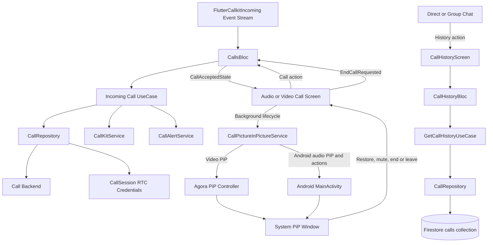

# Feature: Calls

## 1. Business Goal & Value

- **Purpose:** Process calls, prepare RTC session data, and display persisted call history.
- **User Stories Covered:** Accept, decline, and cancel incoming calls from CallKit; review call direction,
  media type, timestamp, and duration in a direct or group conversation.

## 2. Architectural Blueprint (Clean Architecture)

### Domain Layer

- **Models:** `CallDataEntity` contains the CallKit and RTC fields supplied by the incoming-call payload.
- **Use Cases:**
    - `AcceptIncomingCallUseCase` accepts a call, dismisses the native screen, and returns a `CallSession`.
    - `DeclineIncomingCallUseCase` rejects the call and stops call alerts and the native screen.
    - `CancelIncomingCallUseCase` stops call alerts and dismisses the native screen.
- **Bloc Events and States:** `CallKitEventReceived` forwards native plugin events to `CallsBloc`; `CallAcceptedState`
  carries the call payload and RTC session, while `CallsState.acceptedCallData` keeps the payload available through
  `copyWith` and resume restoration. RTC participant-media updates are matched against `acceptedCallData.callId` when an
  accepted state does not expose an `activeCall`, so the accepted session's media state is not discarded. Terminal
  outcomes emit an idle `CallEndedState` with a unique terminal event ID; active call, RTC session, and media
  participant data are cleared, while the authenticated recipient identity is retained for the next call. That identity
  is cleared when incoming-call listening stops on logout. Root navigation and incoming-call dialogs remain driven by
  UI-layer Bloc listeners.
- **Bloc Internal Components:** `CallsBloc` creates one `CallKitEventBridge` for the injected plugin stream and closes
  it with the Bloc; the bridge only forwards non-null plugin events as `CallKitEventReceived`. CallKit actions that
  affect call state remain handled by the Bloc so they share its lifecycle reservation and terminal-state guards.
  `CallsRtcCoordinator`, owned by the Bloc, handles RTC join deduplication, RTC stream subscriptions, media commands,
  and leaving the RTC session. `CallsFirestoreWatchCoordinator` owns only the incoming-call and active-call Firestore
  subscription handles. `CallsBloc` still chooses when to start, replace, stop, and close those subscriptions,
  constructs `ActiveCallUpdated` with the watched call ID and generation, handles stream errors, and validates event
  freshness before changing state. The coordinator reports no call state itself; `CallsBloc` remains the sole owner of
  `CallsState` transitions.
- **Lifecycle Concurrency:** Bloc event handlers remain concurrent across event types. `CallsBloc` reserves one
  lifecycle action per call ID before awaiting UseCases, rejects duplicate starts while a call is being created, and
  deduplicates terminal outcomes. Firestore updates carry both `watchedCallId` and a watch-generation token; terminal
  updates received during an action are deferred until its reservation is released, then ignored if that action already
  ended the same call. RTC join deduplication is scoped to the owned `CallsRtcCoordinator` and is cleared during
  terminal cleanup.
- **Navigation and Restore:** The app restores persisted CallKit actions before starting the Firestore incoming-call
  listener. Pending accept IDs remain suppressed while queued events drain, preventing a Firestore snapshot from opening
  a duplicate dialog. The in-app incoming dialog is shown only while the app is resumed; while backgrounded, incoming UI
  belongs to CallKit. `CallAcceptedState` routes through the root navigator once per call ID; the app also rechecks the
  current accepted state after restoration and resume in case the state was emitted before the navigation listener was
  ready. On app resume it refreshes preferences and checks `FlutterCallkitIncoming.activeCalls()` as a fallback.
  Android's main Flutter activity uses `singleTop` so CallKit's accept intent can be delivered to the existing app
  activity.
- **Repository Interface:** `FirestoreCallRepository` uses Firestore transactions for accept, reject, leave, invite,
  cancel, and end. It validates the authenticated actor and the current call/participant status before writing. Ordinary
  accept changes `ringing` to `active`; active group invite acceptance changes only the invitee record. Leave changes
  the caller's participant record while preserving `calleeIds`, or marks a callee `left` and removes that identity;
  neither leave nor invite writes call-level terminal fields. A group decline changes only the declining participant.
  Missing calls, invalid transitions, and Firestore read/write failures propagate to the caller.
- **Call History:** `GetCallHistoryUseCase` reads call documents from the existing `calls` collection through
  `CallRepository.getCallHistory`. Group history queries are scoped by `groupId` and `isGroup`; Firestore Rules permit
  access only to members of the matching `workingGroups/{groupId}` document. Direct history queries use only the current
  user's authenticated Firebase UID/email aliases against `callerId` and `calleeIds`, then filter the results by the
  requested opponent and call participants. This includes participants who left and were removed from `calleeIds`.
  Results are ordered by `createdAtMillis` descending with document ID as a stable tie-breaker. History is loaded in
  pages of 20 records. Direct alias query windows are merged and deduplicated before returning a page; the cursor
  preserves the stable ordering across requests. Required composite indexes are defined in `firestore.indexes.json`.
  No additional Firestore collection, call document field, or schema migration is required.
- **History Classification and Duration:** Direction is based on the current user's normalized identity matching
  `callerId`. An incoming call is missed for a recipient if that recipient did not connect before the call reached a
  terminal state. “Declined” and “unanswered” are not distinguished; no field or status is added for that distinction.
  For group calls, classification uses the current user's own participant record, not the call-wide `startedAt`: a
  participant who did not connect sees a missed call even if another group member connected. A participant who did
  connect does not see it as missed. Call duration is the whole session interval, `endedAt - startedAt`; ringing and
  answer-wait time are excluded, and individual group participation duration is not calculated. Duration is omitted
  when either session timestamp is absent.
- **Abrupt process termination:** Flutter cleanup cannot be relied on after Android force-stop or process kill. Cloud
  Functions seed server-timestamp heartbeats when a participant becomes connected; while connected to RTC,
  `CallLivenessCoordinator` refreshes `calls/{callId}/heartbeats/{participantId}` every 15 seconds. It also invokes
  `reconcileStaleCallParticipants` every 10 seconds; Agora's `onUserOffline` triggers an immediate extra check and the
  RTC event is tagged with its owning `callId`. The function verifies that the requester is a connected call member,
  then independently checks all other connected members' server-written heartbeats. A heartbeat at least 30 seconds old
  marks a group participant `left` and removes them from `calleeIds`, or ends a direct call. The endpoint chooses stale
  members itself; the client cannot nominate a target. `GroupCallScreen` also hides a participant as soon as Agora
  reports them absent. The scheduled `expireStaleCallParticipants` function remains a fallback when no peer can
  reconcile: it runs every minute and cleans heartbeats older than two minutes, rechecking the call and heartbeat inside
  a transaction. Firestore Rules and the heartbeat collection-group index remain required for heartbeat writes and
  fallback queries. This change requires deploying the Cloud Function and installing an app build with the 10-second
  reconciliation timer; no Firestore Rules change is needed.

### Data Layer

- **Remote Data:** `CallRepository` implementation sends accept/reject requests to the configured backend.
- **Native Integration:** `CallKitService` abstracts the platform call UI; `CallKitServiceImpl` uses the local
  `packages/flutter_callkit_incoming` fork. On Android, the lock-screen activity listens for a package-scoped end
  broadcast; the intent must not target the Activity component, or the dynamic receiver will not receive the request to
  finish.
- **Push Payload:** The FCM background handler accepts `incoming_call` and `cancel_call` in either the `action` or
  `type` field. It registers the CallKit action callback in the FCM-started process before presenting an incoming call,
  so native Decline can reach Dart even when Android had to recreate the process. Incoming call messages include the
  target `calleeId`, allowing a background decline to reject the correct call participant. The handler logs message
  receipt and CallKit presentation under `[FCMCall]`; Cloud Function `onCallCreated` logs recipient-token counts and
  per-send FCM errors. The foreground notification listener ignores call messages; the app's incoming-call UI remains
  the foreground control surface.
- **CallKit Actions:** A background CallKit event handler persists Accept actions and queues Decline for retry if its
  Firestore write fails. A native Decline uses the recipient ID from the call payload if app authentication state is not
  yet restored, so the Firestore rejection does not wait for Bloc identity initialization. Decline cleanup still
  dismisses native UI and stops ringing when the remote write fails. Accepted CallKit calls subscribe to Firestore
  updates so a remote hangup ends local RTC state. Terminal call status changes (`cancelled`, `rejected`, or `ended`)
  send cancellation pushes even after the call became active; the client dismisses the native ongoing-call notification
  and clears matching call state. Call dismissal also clears the Android incoming notification and ringing audio.
- **Terminal call outcomes:** Rejection, cancellation, end, leave, timeout, permission denial, accept failure, and RTC
  connection failure share terminal cleanup. `CallsBloc` returns to `idle`, preserves the authenticated user ID, clears
  stale active call/session data, and records an error once when relevant. Root navigation displays terminal errors
  once; call screens and incoming dialogs close only on a status transition, avoiding repeated pops.
- **Group Calls & Dynamic Invitations:** When initiating a group call from a group chat, all group participants
  (excluding the caller) are passed as `calleeIds`. Participant records are stored in the Firestore `participantsByUser`
  map, keyed by normalized email or Firebase UID, and converted back to the `Call.participants` list for UI. The group
  call host immediately joins Agora RTC session and transitions `CallsStatus` to `active`, bypassing the 1-to-1 outgoing
  dial tone and 45-second timeout. Incoming call streams monitor both `ringing` calls and `active` calls where the
  authenticated user's email or UID has a ringing record. When a participant leaves a group call (`leaveCall`), they are
  removed from `calleeIds` and their record changes to `left`; `GroupCallScreen` filters out participants with `left` or
  `declined` status. A caller may re-invite a `left` or `declined` participant during an active group call, returning
  only that user's map entry to `ringing`; the participant can accept by changing their own entry to `connected` without
  changing the call status or other records. Cloud Function `onCallUpdated` detects new callees and participant map
  entries that transition to `ringing`, dispatching `incoming_call` FCM data pushes to wake backgrounded or locked
  devices. It also aggregates group declines and departures because client Rules do not permit participants to rewrite
  other entries to calculate group-wide terminal status. `CallsBloc` clears prior resolution flags for active calls with
  ringing participants, allowing re-invited devices to present the incoming call dialog and rejoin the call.
  `CallAcceptedState` retains `activeCall` state so group call screens display the full participant grid with email
  identifiers and call duration timer.
- **Agora Video Streaming & Group UID Synchronization:** For video calls, `AgoraRtcService` applies mobile-optimized
  video encoder configurations (`640x360 @ 15fps, 600 kbps`) and enables dual-stream mode upon session start.
  `AgoraUidMapper` derives positive 31-bit UIDs from SHA-256 of normalized call participant IDs. The same mapper
  instance is injected into `FirestoreCallRepository` and `AgoraRtcService`; the repository sends the computed local UID
  to the token function and carries the verified roster mapping in `CallSession`. RTC verifies that the session UID
  matches the stable mapping before `joinChannel`, and the video factory resolves remote views through that mapping.
  Email is normalized to lowercase while Firebase UID case is preserved. The current user's email/UID aliases are linked
  only from `FirebaseAuth`; other participant IDs use the canonical identifier stored in that call. A hash collision
  within a call roster aborts session preparation with an explicit error rather than assigning order-dependent UIDs.
  `GroupCallScreen` matches media states by normalized participant identity and does not compute a separate UID. The
  `calls` document schema remains unchanged and does not persist Agora UIDs. Every new RTC session resets microphone
  mute and speakerphone to off and configures camera tracks from the session media type; the current speakerphone route
  is applied after Agora confirms channel entry. `leaveSession` resets SDK media, routing, and the in-memory participant
  mapping. Background camera suspension remains distinct from the user's manual camera toggle.
- **Picture in Picture and Background Lifecycle:** `AudioCallScreen`, `VideoCallScreen`, and `GroupCallScreen` request a
  compact call presentation when the app is hidden or paused. If PiP entry succeeds, the screen keeps the call active
  and
  does not dispatch the lifecycle event that would suspend video; unsupported/failed entry still forwards lifecycle
  handling to `CallsBloc`. The Bloc does not end a call on `detached`. `CallPictureInPictureService` owns the Agora PiP
  controller for video and the Android native bridge for audio-only PiP. The shared PiP widget renders participant/video
  content only; Flutter-rendered action buttons are unsupported in PiP on both Android and iOS. A tap on the Android
  PiP window reveals the system controls:
  the system expand action restores the call, and native actions toggle the microphone or perform the
  context-appropriate end/leave action. The microphone action's icon and label reflect its current mute state and
  refresh after each successful `CallsBloc` microphone change without restarting the foreground service. When call
  cleanup completes while the Activity remains in PiP, the Android
  host Activity finishes and the PiP window closes. Ending a call outside PiP retains the existing in-app navigation.
  Android audio calls prepare native PiP parameters while the call is active. Android 12+ uses system auto-enter;
  Android 8–11 enter from `MainActivity.onUserLeaveHint`. The Flutter lifecycle-triggered entry remains an idempotent
  fallback if the system entry has not happened yet.
  iOS video uses Agora PiP and returns to the app through the system PiP interaction; iOS does not expose app-defined
  PiP mute/end controls. iOS audio-only PiP is unsupported. iOS background audio mode is enabled so audio can continue
  while the app
  is backgrounded. Preparing PiP for any active Android RTC call starts the app-owned ongoing-call foreground service,
  independent of whether CallKit started its own service. It holds a partial CPU wake lock so the existing 15-second
  client heartbeat continues during PiP; call-service teardown stops the service and releases the lock. Server
  reconciliation still treats a heartbeat older than 30 seconds as stale. Force-stop, process death, or network loss
  can stop heartbeats and still trigger the existing stale-call cleanup. Remote hangup and user end/leave continue
  through the existing Bloc terminal cleanup. `FirestoreCallRepository` selects the heartbeat document key from the raw
  participant map using the authenticated ID-token email claim first, then Firebase UID, matching Firestore Security
  Rules. It checks that the selected participant is connected, reads the call document separately from the heartbeat
  write, and reports the rejected operation and Firebase error code without logging raw email or UID values.

### Presentation Layer (UI & Bloc)

- **Call History:** `CallHistoryBloc` loads the requested direct or group history through
  `GetCallHistoryUseCase` in pages. `CallHistoryScreen` renders a newest-first vertical list with a direction/missed
  icon, localized audio/video description, localized date and time, and whole-session duration. A terminal call is
  marked missed for the current recipient when their own participant record has no connection; decline and no-answer
  share this classification. The screen requests more records near the end of the list and also fills a short first
  page. A later-page error keeps the loaded records and cursor available for retry. Initial load errors expose a
  localized retry action, and missed-call icons use the theme error color. The Direct chat and group chat app bars
  expose the screen through a history icon beside their call controls.

- **Native Actions:** Use cases can be called from native CallKit action callbacks without requiring the in-app call UI.
- **Responsive Group Call Grid & Controls:** `GroupCallScreen` renders 1-2 participants in single-column layout and
  switches to a 2-column `GridView` for 3+ participants. Grid cells responsively scale avatar radius, text sizes, and
  padding depending on column count. Participant name tags wrap in an `Expanded` container with `TextOverflow.ellipsis`,
  ensuring long email addresses and suffixes (`(You)`, `(Calling...)`) never trigger `RenderFlex` overflows. For ringing
  participants, a prominent status badge with spinner renders below the center avatar. The bottom controls bar uses an
  evenly-spaced full-width row with compact padding, ensuring comfortable button distribution across the entire screen
  width without unwanted margins.
- **Compact Call Surface:** The shared `CallPictureInPicture` widget renders participant/video content only on Android
  and iOS; it has no `showControls` option or app-defined action callbacks. Android displays native controls after the
  user taps the PiP window. The built-in expand control restores the existing call screen; native microphone and direct-
  end/group-leave actions are routed to `CallsBloc`. The native microphone action uses separate enabled and muted icons
  and an action label matching the current state. Terminal call cleanup closes the PiP Activity when it is still in
  PiP. iOS video PiP returns to the call through the system restore interaction and does not provide app-defined PiP
  mute/end buttons. iOS audio-only PiP is unsupported.
- **Feature Localization (l10n/i18n):** All presentation layer components (`IncomingCallDialog`, `AudioCallScreen`,
  `VideoCallScreen`, `GroupCallScreen`) strictly consume localized text from `AppLocalizations` across English (`en`),
  Russian (`ru`), and Ukrainian (`uk`). Localized strings cover incoming call alerts, call and RTC connection states
  (`calling`, `ringing`, `connecting`, `reconnecting`, `failed`, `disconnected`), action tooltips and buttons (`mute`/
  `unmute`, camera toggles, switch camera, speaker, end call, leave call, end for all), invitation dialog fields, and
  participant badges. Business logic in `domain` and `data` remains strictly separated without any UI or localization
  coupling.

## 3. Testing Matrix

| Behavior or component                          | Test file                                                                                                    | Cases covered                                                                                                                                                                                                                                                                        |
|:-----------------------------------------------|:-------------------------------------------------------------------------------------------------------------|:-------------------------------------------------------------------------------------------------------------------------------------------------------------------------------------------------------------------------------------------------------------------------------------|
| `Call.isMissedFor` and session duration        | `test/features/calls/domain/call_history_classification_test.dart`                                           | Direct terminal outcomes share the missed classification; group outcome is per participant connection; whole-session duration excludes ringing and does not calculate per-participant duration.                                                                                      |
| Firestore Direct and group history queries     | `test/features/calls/data/firestore_call_repository_test.dart`                                               | Authenticated UID/email aliases, opponent filtering, alias deduplication, stable ordering and cursor boundaries, and group page boundaries.                                                                                                                                          |
| In-memory history pages                        | `test/features/calls/data/firestore_call_repository_test.dart`                                               | Page size, cursor continuation, stable ordering, and page boundary behavior.                                                                                                                                                                                                         |
| `GetCallHistoryUseCase` and `CallHistoryBloc`  | `test/features/calls/ui/call_history_bloc_test.dart`                                                         | Initial page request, append, boundary deduplication, and preserving loaded rows/cursor after a later-page error.                                                                                                                                                                    |
| `CallHistoryScreen`                            | `test/features/calls/ui/call_history_screen_test.dart`                                                       | Initial load and retry, missed icon/error color, list/empty state, near-end and short-page loading, and later-page retry.                                                                                                                                                            |
| History localization                           | `test/features/calls/ui/call_history_screen_test.dart`                                                       | Retry action rendered using generated localization; source strings are in `lib/l10n/app_{en,ru,uk}.arb`.                                                                                                                                                                             |
| Firestore call-history authorization           | `firestore-rules-tests/calls.rules.test.cjs`                                                                 | Authenticated Direct history access, peer-only query denial, group member access, and non-member denial.                                                                                                                                                                             |
| Firestore query indexes                        | `firestore.indexes.json`                                                                                     | Source definitions cover caller/callee alias queries and group query ordering. Deploying index configuration is a separate operation.                                                                                                                                                |
| Other call behavior                            | `test/features/calls/`                                                                                       | Repository calls, RTC session result, alert stop, CallKit dismissal, Agora UID mapping, RTC cleanup, and liveness behavior.                                                                                                                                                          |
| Background call lifecycle                      | `test/features/calls/ui/calls_bloc_test.dart`                                                                | A detached Flutter view does not end a direct video or group audio call; active RTC state and user media choices remain.                                                                                                                                                             |
| PiP compact call content and screen forwarding | `test/features/calls/ui/video_and_group_call_screens_test.dart`                                              | Compact PiP renders participant content without Flutter action controls on either platform; call screens forward Bloc mute changes to Android native PiP action state.                                                                                                               |
| PiP service and native channel contract        | `test/features/calls/data/services/call_picture_in_picture_service_test.dart`                                | Android audio PiP preconfiguration precedes entry; native mic-state refresh does not restart the foreground service; action parsing and dismissal on teardown.                                                                                                                       |
| Heartbeat participant-key alignment            | `test/features/calls/data/firestore_call_repository_test.dart`; `firestore-rules-tests/calls.rules.test.cjs` | Repository tests verify ID-token email claim selection, UID fallback, and stage-specific client errors; Rules emulator tests verify allowed heartbeat create/refresh and denied wrong-alias/stranger writes. Both suites pass. Android PiP beyond 30 seconds remains a device check. |
| Native PiP and Android call foreground service | Android/iOS device scenario                                                                                  | Not run: verify audio PiP entry on Android 8–11 and 12+, video PiP system controls, dismissal after local/remote call end, app-owned service and 15-second heartbeat below the unchanged 30-second stale threshold; verify force-stop cleanup and iOS background media.              |

## 4. Data Flow & State Machine (Mermaid)

