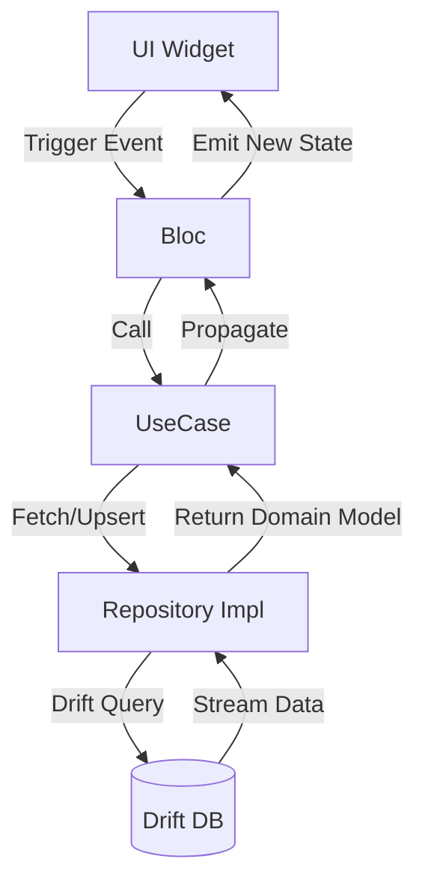

# Feature: [Feature Name in UpperCamelCase]

## 1. Business Goal & Value

- **Purpose:** [Short technical description of what this feature solves]
- **User Stories Covered:** [Brief list of tech requirements]

## 2. Architectural Blueprint (Clean Architecture)

### Domain Layer

- **Models:**
    - `[FeatureName]Model` (Fields, immutability, copyWith)
- **Use Cases:**
    - `[Action][Target]UseCase` -> [Brief description of inputs/outputs]
- **Repository Interface:**
    - `I[FeatureName]Repository` -> [Contract methods]

### Data Layer

- **Local Persistence (Drift):** [Tables, Dao or entities involved. Note if migration is needed]
- **Data Mappers:** [Entity to Domain Model mapping logic]
- **Remote Data (if applicable):** [API contracts or local data source logic]

### Presentation Layer (UI & Bloc)

- **Bloc / Cubit:** `[FeatureName]Bloc`
    - **Events:** `[FeatureName]Event` (List expected events)
    - **States:** `[FeatureName]State` (Initial, Loading, Success, Error with TaskErrorType)
- **Components & Screens:**
    - `[FeatureName]Screen` -> Main entry point
    - `[FeatureName]Dialog` -> [If modal UI state is needed, specify QuillController ownership if rich text is used]

## 3. Testing Matrix

For every new or changed behavior-bearing component, record the component, its test file, and the behaviors or cases
covered. Prefer focused tests at the layer that owns the behavior. A higher-level test may cover a component when that
gives meaningful coverage; state the reason when a component has no direct test.

| Component                      | Layer                                         | Test file(s)         | Behaviors and cases covered                              |
|:-------------------------------|:----------------------------------------------|:---------------------|:---------------------------------------------------------|
| [Component or N/A with reason] | [Domain / Data / Bloc / Widget / Integration] | [test/..._test.dart] | [Success, error, edge, interaction, or regression cases] |

- [ ] **Domain:** Test model behavior, UseCase inputs/outputs, and repository-contract interactions where present.
- [ ] **Data:** Test mapping, persistence, and repository success/error behavior where present.
- [ ] **Persistence and migrations:** When Drift schema or persistence changes, test data behavior and supported schema
  upgrades.
- [ ] **Bloc/Cubit:** Test relevant loading, success, error, and side-effect transitions with `blocTest`.
- [ ] **Widgets and screens:** Test relevant rendered states and user interactions. Reset and reinitialize DI as
  specified in `AGENTS.md`.
- [ ] **Integration or regression:** Cover cross-layer behavior or the original failure when relevant.

Mark inapplicable layers as `N/A` with a short reason. Do not use a repository-wide coverage percentage as a substitute
for mapping components to tests.

## 4. Data Flow & State Machine (Mermaid)

